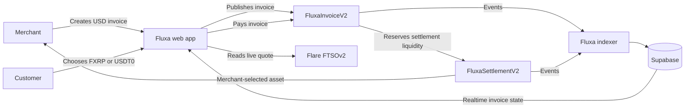

<p align="center">
  
</p>

# Fluxa

**Crypto invoices with flexible payment and settlement on Flare.**

Fluxa lets a merchant create a USD-denominated invoice, choose which assets a
customer may pay with, and separately choose the asset the merchant wants to
receive. Customers pay with FXRP or USDT0 on Coston2, while Fluxa uses Flare
FTSOv2 pricing, on-chain verification, and reserve-backed settlement to complete
the invoice.

> Built for the Flare Summer Signal hackathon, Track 1: Interoperable Asset
> Products. Fluxa currently runs on the Coston2 testnet and uses test assets only.


## Product vision

Fluxa's vision is to make cross-asset crypto commerce feel as clear as ordinary
invoicing. A merchant should be able to state a price in familiar business terms
and receive a preferred settlement asset, while the customer pays with a supported
asset already in their wallet. Flare supplies the decentralized pricing and
interoperable asset infrastructure that turns that choice into verifiable
settlement.

## Problem and users

Fluxa is built for freelancers, agencies, digital merchants, and online businesses
that want to accept crypto without forcing every customer to acquire one specific
token or forcing the merchant to keep an unwanted asset. Existing crypto payment
flows commonly couple the asset spent by the customer to the asset received by the
merchant, leaving pricing, conversion, and reconciliation as manual work.

Fluxa separates those decisions: the merchant creates a USD invoice and chooses
the settlement asset; the customer opens one link and pays with an accepted asset.

## Why Flare is required

| Flare capability | What it does in Fluxa |
| --- | --- |
| FTSOv2 | Supplies decentralized XRP/USD and USDT/USD prices for invoice quotes and cross-asset settlement calculations. |
| FAssets / FXRP | Makes XRP-derived value usable by Fluxa's EVM contracts as a supported six-decimal payment and settlement asset. |
| Coston2 EVM | Enforces invoice state, quote protection, token movement, reserve checks, and settlement evidence on-chain. |
| Flare Data Connector | Powers the separately implemented and tested native-XRP verification rail. This rail is not enabled in the primary V2 checkout demo. |

Without Flare, Fluxa would need a centralized price API and could not make its
current on-chain FXRP payment and cross-asset settlement flow work as designed.

## Core features

- Wallet-only merchant authentication; no email account is required.
- USD-denominated invoices with shareable public payment links.
- Merchant-selected payment assets: FXRP, USDT0, or both.
- A separate merchant-selected settlement asset.
- Live FTSOv2 quotes with exact token amounts and quote protection.
- Reserve-capacity checks before cross-asset payment.
- Atomic payment behavior when reserve liquidity is insufficient.
- Same-asset and cross-asset settlement on Coston2.
- Supabase-backed invoice history, realtime status updates, and public invoice views.
- A chain indexer that records payment and settlement evidence in Supabase.
- Backward compatibility for existing V1 invoices and payment links.

C2FLR is used only for Coston2 gas. It is not an invoice payment asset.

## How it works



For a cross-asset payment, the merchant's settlement asset is delivered from
the funded settlement reserve. The asset paid by the customer remains in the
settlement contract and replenishes the other side of the reserve inventory.

## Technology

| Layer | Technology |
| --- | --- |
| Frontend | React 19, TypeScript, Vite, Tailwind CSS |
| Wallet and chain | Wagmi, Viem, Flare Coston2 |
| Smart contracts | Solidity, Hardhat, OpenZeppelin |
| Pricing | Flare FTSOv2 |
| Database and auth | Supabase PostgreSQL, RLS, Edge Functions |
| Event synchronization | Node.js, TypeScript, Ethers, Supabase |
| Hosting | Vercel-ready SPA configuration |

## Repository structure

```text
Fluxa/
|-- contracts/   Solidity contracts, tests, deployment and reserve scripts
|-- database/    Ordered Supabase migrations
|-- docs/        Flare validation and implementation notes
|-- frontend/    React merchant workspace and public checkout
|-- services/    Coston2 event indexer
|-- supabase/    Edge Functions and function configuration
|-- README.md
```

## Coston2 deployment

| Contract or token | Address |
| --- | --- |
| FluxaInvoice V1 | `0x3cEb0760C7F2bd58B1D2A60813112CFC42E9D9e4` |
| FluxaSettlement V1 | `0x4fAAa888a4D220D060a1323a9831d846B055F0D2` |
| FluxaPriceOracle | `0xc7705bE0dac98590F28c738Ffc8b2C1e5282620c` |
| FluxaFdcPaymentRail | `0xB16d796F7eF09eF7c14644AaFAcc59013FBB15f8` |
| FluxaInvoiceV2 | `0xa7a76084C0AD139504Ef1184f2d0A6054c019aA0` |
| FluxaSettlementV2 | `0x7F4b2E77f0BbCA9856c620F5606a9618809eE34a` |
| FXRP | `0x0b6A3645c240605887a5532109323A3E12273dc7` |
| USDT0 | `0xC1A5B41512496B80903D1f32d6dEa3a73212E71F` |

Deployment evidence is stored in
[`contracts/deployments/coston2.json`](contracts/deployments/coston2.json) and
[`contracts/deployments/coston2-v2.json`](contracts/deployments/coston2-v2.json).

## Verified end-to-end result

The V2 flow has been completed on Coston2 with two wallets and real testnet
transactions:

| Evidence | Verified value |
| --- | --- |
| Invoice | `$2.00`, contract version 2, invoice ID `514e5782-9fa1-42ec-9234-73a4100e7e08` |
| Customer payment | `1.998326 FXRP` |
| Merchant settlement | `2.002223 USDT0` |
| Final indexed status | `SETTLED` |
| Payment transaction | [`0x3e273a...a49a51d`](https://coston2-explorer.flare.network/tx/0x3e273af35be221c5059cf4bbfdb62e1f7671addd3ea20de0fc6775b78a49a51d) |
| Settlement transaction | [`0x9e13e3...f2a3c967`](https://coston2-explorer.flare.network/tx/0x9e13e39628fa685d86ffbca9f5720b4a08976e4eceb98adbe00cb830f2a3c967) |

Judges can independently verify the transactions in the Coston2 explorer, inspect
the V2 contracts at the addresses above, and reproduce the implementation through
the contract, service, and frontend test commands below.

## What is real, trusted, mocked, or incomplete

| Area | Current status |
| --- | --- |
| Merchant wallet authentication | **Real:** wallet challenge and signature verification through a deployed Supabase Edge Function. |
| Invoice creation and publication | **Real:** persisted in Supabase and published to `FluxaInvoiceV2` on Coston2. |
| FXRP and USDT0 checkout | **Real:** live Coston2 token approvals, payments, reserve checks, and settlement. |
| Pricing | **Real:** the browser reads FTSOv2 contracts directly; no mock price API is used in the live app. |
| Merchant invoice state | **Real:** indexed chain events are stored in Supabase; the dashboard uses database realtime updates with a 15-second polling fallback. |
| Cross-asset liquidity | **Trusted MVP component:** settlement comes from a project-funded reserve contract. This is not a DEX swap or permissionless liquidity network. |
| Landing-page invoice illustration | **Illustrative:** the `$500` card is a static product example, not a live invoice. Dashboard and public payment-link data are live. |
| Native XRP / FDC rail | **Implemented and tested, not enabled in the primary V2 checkout UI:** contracts and Coston2/FDC tests are included in the repository. |
| Network and funds | **Testnet only:** Coston2 assets have no real value. |
| Production readiness | **Incomplete:** no independent security audit, production liquidity system, or mainnet deployment has been completed. |


## Local setup

### Requirements

- Node.js 22 recommended
- npm
- A browser wallet that supports custom EVM networks
- A Supabase project
- Coston2 test assets from the [Flare faucet](https://faucet.flare.network/coston2)

### 1. Install dependencies

```bash
git clone <your-github-repository-url>
cd Fluxa

cd contracts && npm install
cd ../services && npm install
cd ../frontend && npm install
cd ..
```

### 2. Configure server-side environment variables

Copy `.env.example` to `.env` at the repository root. At minimum, the indexer
requires:

```env
SUPABASE_URL=https://your-project.supabase.co
SUPABASE_SERVICE_ROLE_KEY=your-service-role-key
COSTON2_RPC_URL=https://coston2-api.flare.network/ext/C/rpc
```

`PRIVATE_KEY` is required only for contract deployment or reserve-funding
scripts. Use a dedicated testnet wallet and never commit the key.

### 3. Configure the frontend

Copy `frontend/.env.example` to `frontend/.env.local` and provide the Supabase
publishable key:

```env
VITE_SUPABASE_URL=https://your-project.supabase.co
VITE_SUPABASE_ANON_KEY=your-publishable-key
VITE_INVOICE_REGISTRY_ADDRESS=0x3cEb0760C7F2bd58B1D2A60813112CFC42E9D9e4
VITE_SETTLEMENT_VAULT_ADDRESS=0x4fAAa888a4D220D060a1323a9831d846B055F0D2
VITE_INVOICE_REGISTRY_V2_ADDRESS=0xa7a76084C0AD139504Ef1184f2d0A6054c019aA0
VITE_SETTLEMENT_VAULT_V2_ADDRESS=0x7F4b2E77f0BbCA9856c620F5606a9618809eE34a
```

Only `VITE_*` variables are exposed to the browser. Never add a private key or
Supabase service-role key to Vercel or any `VITE_*` variable.

### 4. Configure Supabase

Run the SQL files in `database/migrations/` in numeric order, from `0001` through
`0007`.

Deploy both Edge Functions from `supabase/functions/`:

- `wallet-auth`
- `publish-invoice`

The repository's `supabase/config.toml` disables platform JWT verification for
these functions because they perform their own request and wallet-session
validation.

### 5. Start the frontend

From the repository root:

```bash
npm run dev
```

Open `http://localhost:5173`.

The equivalent package-level command is `cd frontend && npm run dev`.

### 6. Synchronize chain events

```bash
cd services
npm run sync:once -- --network coston2
```

For a long-running environment, run `npm run sync -- --network coston2` in a
persistent worker rather than inside the Vercel frontend deployment.

## Testing

```bash
# Smart contracts
cd contracts
npm run test:offline
npm run typecheck

# Indexer and reducer
cd ../services
npm test
npm run typecheck

# Frontend and production build
cd ../frontend
npm test
npm run typecheck
npm run build
```

Current automated baseline:

- 195 smart-contract tests
- 23 service/indexer tests
- 68 frontend/data-layer tests
- Successful live Coston2 cross-asset payment and settlement verification

## Vercel deployment

Import the repository into Vercel and use:

```text
Root Directory: frontend
Framework Preset: Vite
Build Command: npm run build
Output Directory: dist
Node.js Version: 22.x
```

Add the six public `VITE_*` values shown above. The committed
[`frontend/vercel.json`](frontend/vercel.json) rewrites direct routes such as
`/invoices` and `/i/:invoiceId` to the React SPA.

## Security notes

- Supabase Row Level Security protects merchant-owned data.
- Public payment links read through a restricted database function, not direct
  anonymous table access.
- The invoice publishing Edge Function verifies the on-chain receipt and invoice
  terms before changing a draft to `OPEN`.
- Contracts protect against duplicate payments, duplicate settlements,
  unauthorized cancellation, stale or invalid quotes, hostile ERC-20 behavior,
  and insufficient reserve liquidity.
- `.env` and `frontend/.env.local` are ignored by Git.

Fluxa is a testnet MVP and has not received an independent production security
audit. Do not use it with real funds.

## Additional documentation

- [Flare validation](docs/PHASE-0-FLARE-VALIDATION.md)
- [Flare integration](docs/SPRINT-3-FLARE-INTEGRATION.md)
